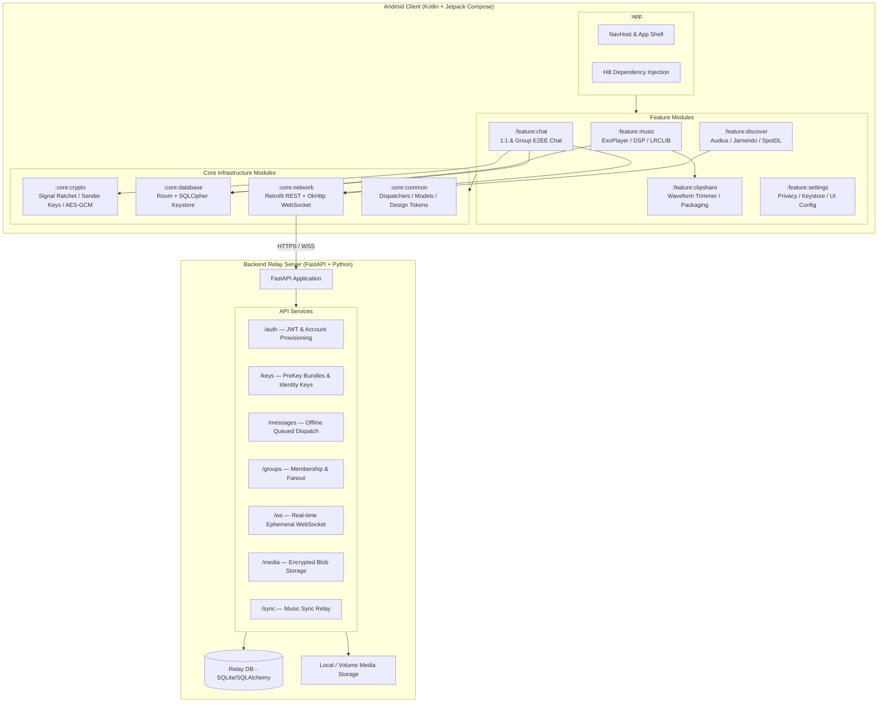
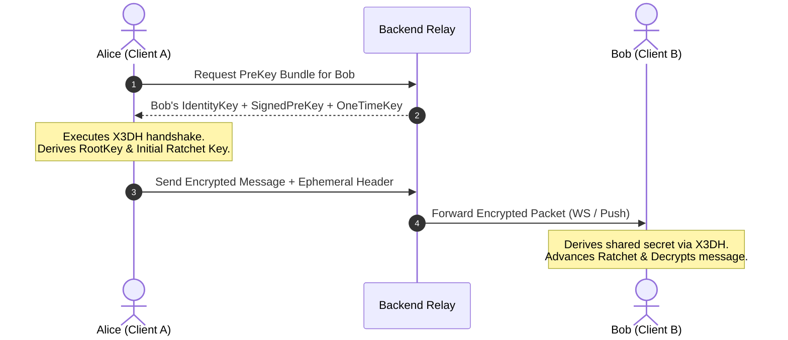
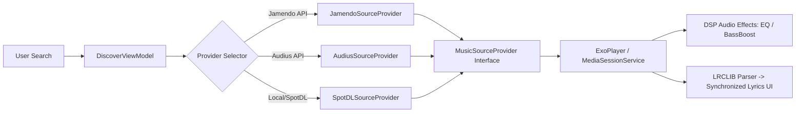

# Nido Architecture Documentation

Complete architectural specification for the Nido privacy-first music player and zero-plaintext end-to-end encrypted messenger ecosystem.

---

## 1. High-Level System Architecture



---

## 2. Architectural Principles

- **Offline-First**: Music library, playlists, lyrics, and chat message history persist locally in an encrypted database.
- **Zero-Plaintext E2EE**: Backend acts strictly as a blind relay and ciphertext repository; it never receives, derives, or stores decrypted text, audio clips, voice notes, or master encryption keys.
- **Strict Multi-Module Separation**: Strict unidirectional dependencies adhering to Clean Architecture principles.
- **Modern Android Stack**: Jetpack Compose (Liquid Glass / Backdrop Material 3 design), Kotlin Coroutines & Flow, Hilt DI, Media3 ExoPlayer, and Room.

---

## 3. Android Modular Breakdown

```
nido/
├── app/                  # Application initialization, Hilt container root, NavHost
├── core/
│   ├── common/           # Shared models, dispatchers, extensions, design tokens
│   ├── crypto/           # Signal Protocol engine, Double Ratchet, Sender Keys, AES-GCM
│   ├── database/         # Room DB, SQLCipher integration, DAOs, Entities
│   └── network/          # Retrofit REST interfaces, OkHttp WebSocket manager, DTOs
└── feature/
    ├── music/            # ExoPlayer service, DSP EQ, LRCLIB parser, library scanning
    ├── chat/             # Chat UI, attachment handling, message ratcheting, voice notes
    ├── discover/         # Remote music search, Jamendo, Audius, SpotDL integration
    ├── clipshare/        # Interactive waveform audio trimmer and encrypted packaging
    └── settings/         # App settings, theme selection, security management
```

### Module Responsibilities

| Module | Primary Responsibilities | Key Dependencies |
| :--- | :--- | :--- |
| `:app` | Application bootstrap, navigation graph, theme host, DI assembly | All `:feature:*`, `:core:*` |
| `:core:common` | Base utilities, coroutine dispatchers, shared Domain Models | Kotlin Stdlib, Coroutines |
| `:core:crypto` | Identity keys, Signal Double Ratchet, Sender Keys, AES-256-GCM | Android Keystore, BouncyCastle / libsignal |
| `:core:database` | SQLCipher-backed Room database, schema migrations, DAOs | Room, SQLCipher, `:core:common` |
| `:core:network` | HTTP REST APIs, OkHttp client, WebSocket heartbeat / reconnect | Retrofit, OkHttp, KotlinX Serialization |
| `:feature:music` | Background playback lifecycle, DSP controls, synced lyrics | Media3 (ExoPlayer), `:core:database` |
| `:feature:chat` | 1:1 and Group conversations, media attachment pipeline, E2EE sync | `:core:crypto`, `:core:database`, `:core:network` |
| `:feature:discover` | Online music streaming, Audius and Jamendo API providers | `:core:network`, `:core:common` |
| `:feature:clipshare` | Visual audio trimming, clip bundling, export to chat | `:feature:music`, `:core:common` |
| `:feature:settings` | Keystore reset, server URL override, theme and privacy controls | `:core:database`, `:core:network` |

---

## 4. Backend Architecture (`backend/`)

The backend is built with **FastAPI** (Python 3.11+) and operates as an asynchronous, zero-knowledge relay node.

### Directory Structure
```
backend/
├── app/
│   ├── auth/             # JWT auth, user registration, login
│   ├── groups/           # Group creation, participant roster, sender key relay
│   ├── keys/             # Signal PreKey bundle upload and retrieval
│   ├── media/            # Encrypted attachment storage and streaming
│   ├── messages/         # Undelivered message mailbox / pull sync
│   ├── stickers/         # Public/shared sticker pack endpoints
│   ├── sync/             # Music synchronization and metadata broadcast
│   ├── ws/               # Real-time WebSocket connection manager & router
│   ├── config.py         # Environment configurations (JWT secrets, DB URL, paths)
│   ├── database.py       # SQLAlchemy engine & session factory
│   ├── main.py           # FastAPI entrypoint, middleware, route mounting
│   └── models.py         # SQLAlchemy ORM models
├── alembic/              # Database migration versions
├── Dockerfile            # Container build specification
└── docker-compose.yml    # Deployment composition (FastAPI + Storage)
```

### API Subsystems & Routing

1. **Authentication (`/auth`)**:
   - Phone/Username-based registration and token issuance.
   - Issues short-lived JWTs for REST and WebSocket authentication.
2. **PreKey Distribution (`/keys`)**:
   - Stores user Identity Keys, Signed PreKeys, and One-Time PreKey pools.
   - Provides clients with bundles to initiate Double Ratchet sessions asynchronously.
3. **Message Relay (`/messages`, `/ws`)**:
   - Real-time message dispatch over WebSockets.
   - Ephemeral queue for offline recipients; payloads deleted immediately upon ACK.
4. **Group Coordination (`/groups`)**:
   - Tracks group membership and admin privileges.
   - Relays encrypted group distribution messages (Sender Key updates).
5. **Encrypted Media Storage (`/media`)**:
   - Stores raw AES-GCM encrypted byte blobs.
   - Enforces SHA-256 deduplication and time-to-live cleanup policies.

---

## 5. Security & Cryptographic Model

### 1:1 Direct Messaging (Signal Double Ratchet)


### Group Messaging (Sender Keys Protocol)
- **Distribution**: Sender generates a random 32-byte Sender Key and ratcheting chain key.
- **Fanout**: Key is encrypted pairwise for every group member via their 1:1 Double Ratchet session.
- **Broadcast**: Subsequent group messages are encrypted once with the Sender Key and relayed to all members.

### Local Data Protection
- **Database**: Encrypted at rest via **SQLCipher**.
- **Passphrase Derivation**: Key stored securely inside Android **Hardware Keystore** (`AndroidKeyStore`).

---

## 6. Playback & Discovery Flow



---

## 7. Technology Stack Matrix

| Layer | Component | Technology |
| :--- | :--- | :--- |
| **Android UI** | Design System | Jetpack Compose, Material 3, Custom Glassmorphism / Backdrop |
| **Architecture** | Pattern | Unidirectional Data Flow (MVI/MVVM), Clean Architecture |
| **Dependency Injection** | DI Framework | Dagger Hilt |
| **Audio Engine** | Playback & DSP | AndroidX Media3 (ExoPlayer), Android AudioEffect DSP |
| **Local Storage** | Database | Room + SQLCipher + Android Keystore |
| **Network Client** | HTTP / WebSocket | Retrofit 2, OkHttp 4, KotlinX Serialization |
| **Cryptography** | E2EE / Ratchet | Signal Protocol (Double Ratchet + Sender Keys), AES-256-GCM |
| **Backend Framework** | Web / API | FastAPI, Uvicorn, Python 3.11+ |
| **Backend Storage** | Database / ORM | SQLite / PostgreSQL, SQLAlchemy, Alembic |
| **Deployment** | Infrastructure | Docker, Docker Compose, Render / Cloud Ready |
